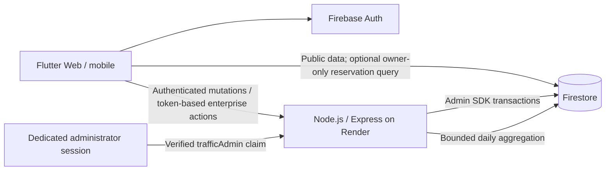

# Boxmatch


[](https://github.com/LEO0331/boxmatch/actions/workflows/deploy-pages.yml)
[](https://github.com/LEO0331/boxmatch/actions/workflows/backend-ci.yml)

BoxMatch is a deployed full-stack surplus-food matching platform for exhibitions. Enterprises publish available meals or drinks; recipients browse listings and a map, reserve pickup windows, and receive handoff codes.

**Live application:** [BoxMatch](https://leo0331.github.io/boxmatch/) · [English system design](docs/system-design-review.en.md) · [繁體中文系統設計](docs/system-design-review.zh-TW.md)

## Capabilities

- Public listing feed and OpenStreetMap venue map; enterprise posting and revocable token-based editing.
- Firebase-authenticated reservations, pickup confirmation, transactional inventory changes, and replay-safe reservation requests.
- Owner-scoped reservation access, private credential metadata, server-derived identities, abuse budgets and server-authoritative writes.
- Optional direct Firestore reservation reads, short-lived UID-scoped memory snapshots, progressive listing details and bounded retries.
- Optional privacy-conscious request intelligence, crawler verification, behavioral risk signals, local country/ASN enrichment, daily aggregates and a protected administrator dashboard with CSV export.

## Architecture and trust boundaries



The public client reads public listing/venue documents and, when explicitly enabled, queries only its authenticated user's reservations. The backend remains authoritative for every business mutation. The existing authenticated reservation-list API is retained as a deliberate rollback path. Direct Firestore reads avoid the Render cold start but are not counted in Express request logs.

The backend and frontend are designed for a free-tier footprint (Render + Firebase Spark + GitHub Pages), not guaranteed always-on availability. Startup performs the privacy migration before opening the HTTP listener; after successful completion, a versioned server-only marker avoids repeating the full scan.

## Data model (Firestore)

| Purpose | Collections |
|---|---|
| Public catalog | `venues`, `listings` |
| Owner-scoped reservations | `reservations` |
| Private credentials and controls | `listing_private`, `security_budgets`, `abuse_signals`, `idempotency_keys` |
| Enterprise verification and policy | `verified_enterprises`, `badge_rules` |
| Business KPI reporting | `kpi_daily`, `kpi_summary`, optional `kpi_events` |
| Operational traffic analytics | `traffic_daily`, `traffic_flushes` |
| Schema migration completion | `schema_migrations` |

See [Firestore rules](firestore.rules) and [indexes](firestore.indexes.json). Client writes to protected collections are denied. Demo-mode local data is separate from production data.

## Run

```bash
flutter pub get
flutter run
```

## Firebase Notes

The app attempts Firebase initialization first.
If Firebase is not configured in the current environment, it automatically falls back to local in-memory demo mode so development can continue.

To enable Firebase mode in production:

1. Create a Firebase project.
2. Add platform configs (`google-services.json`, `GoogleService-Info.plist`, etc.).
3. Deploy Firestore rules/indexes.

## Security review

- [Security review and finding status (2026-11-25)](docs/SECURITY_REVIEW_2026-11-25.md) — private listing metadata, server-derived enterprise identity, atomic budgets and transaction hardening.
- [Security review and finding status (2026-11-19)](docs/SECURITY_REVIEW_2026-11-19.md) — verified recipient identity, logging, CORS, dependency checks, and remaining abuse-control risks.
- Production recipient operations require Firebase ID tokens; the public web client uses Firebase anonymous authentication. Legacy UID-only requests are no longer accepted by the reviewed Render configuration.

## API Backend (Spark-friendly)

This project now uses a standalone Node API in `server/` (Render deploy) instead of Firebase Functions, so you can stay on Firebase Spark plan.

[Request intelligence](docs/REQUEST_INTELLIGENCE.md) classifies API traffic and records risk signals without automatic blocking. [Traffic analytics](docs/TRAFFIC_ANALYTICS.md) provides bounded, best-effort daily aggregates with explicit missing-data status; it does not track unique visitors or reconstruct historical traffic. The [administrator dashboard](docs/TRAFFIC_DASHBOARD.md) uses a separate non-anonymous Firebase session and a verified `trafficAdmin` custom claim. It is not linked in public navigation.

All optional traffic features default to disabled in source; deployment configuration is operator-controlled. For activation, private credential setup, and reservation read rollout, use the [deployment runbook](docs/ops/deploy-runbook.md). Screenshots in the dashboard documentation use synthetic fixtures, not real traffic.

Set your API URL when building/running Flutter:

```bash
flutter run --dart-define=BOXMATCH_API_BASE_URL=https://<your-render-service>.onrender.com
```

## GitHub Pages (Auto Deploy)

Web app deploy is automated by:

- `.github/workflows/deploy-pages.yml`

On every push to `main`, CI builds Flutter web and deploys to GitHub Pages.

One-time setup in GitHub:

1. Repo `Settings` -> `Pages`
2. `Build and deployment` -> `Source` = `GitHub Actions`
3. (Optional) add repo secret `BOXMATCH_API_BASE_URL` if you want a non-default API URL in web build

### KPI Export (weekly/monthly report)

From repo root:

```bash
cd server
npm run export:kpi:7d
npm run export:kpi:30d
```

## Testing

```bash
flutter analyze
flutter test
```

Web e2e smoke test:

```bash
flutter build web
npm ci
npm run test:e2e:web
```

This runs Playwright against `build/web` and checks core routes for global runtime errors. CI also exercises telemetry/admin-enabled and disabled builds, plus real Firestore emulator security rules against an isolated demo project. See [release checklist](docs/ops/release-checklist.md).

Latest verified baseline (2026-11-26): [five CI checks passed](https://github.com/LEO0331/boxmatch/pull/57/checks), 546 backend tests across 31 suites, 89.32% Flutter coverage (80% gate), and zero vulnerabilities reported by the backend npm audit. These are dated CI results, not a claim about current production data or future dependencies.

### Coverage Gate Rule

- CI workflow: `.github/workflows/flutter-ci.yml`
- Rule: overall coverage is calculated from `coverage/lcov.info`.
- Fail condition: CI fails when overall coverage is **below 80%**.

### Backend PR Gate (Required)

- CI workflow: `.github/workflows/backend-ci.yml`
- Job: `Backend Tests (Jest)`
- Fail condition: any backend lint/test failure blocks this check.

To enforce merge blocking in GitHub:

1. `Settings` -> `Rules` -> create/edit ruleset for `main`
2. Enable `Require status checks to pass`
3. Add required checks:
   - `test-and-coverage` (from Flutter CI)
   - `Backend Tests (Jest)` (from Backend CI)
   - `owner-reservation-rules` (from Firestore Rules CI)
   - `browser (false)` and `browser (true)` (from Traffic Web CI, for applicable frontend changes)
   - Account for path-filtered workflows when configuring required checks so documentation-only changes do not become permanently blocked.
4. Keep `Require branches to be up to date before merging` enabled

## Release Smoke + Gate

Production deploy gate workflow:

- `.github/workflows/release-checklist-gate.yml`
- checklist doc: `docs/ops/release-checklist.md`

## Seed Testing Data (POC)

Generate multiple demo listings/reservations via backend API
Optional knobs:

- `SEED_LISTING_COUNT` (default `6`)
- `SEED_RESERVE_COUNT` (default `3`)
- `SEED_CONFIRM_COUNT` (default `1`)

## Execution Board

- 30-day POC board for GitHub Wiki:
  - [docs/wiki/30-day-poc-board.md](https://github.com/LEO0331/boxmatch/wiki/30%E2%80%90Day-POC-Execution-Plan-(Free%E2%80%90Tier-First))

## Postman API Collection

Recommended run order in collection:

1. `Health`
2. `Enterprise - Create listing`
3. `Enterprise - Validate token`
4. `Recipient - Reserve listing`
5. `Recipient - Reserve replay (same idempotency key)`
6. `Recipient - List my reservations`
7. `Recipient - Cancel reservation`
8. `Enterprise - List reservations`
9. `Enterprise - Update listing`
10. `Enterprise - Confirm pickup`
11. `Enterprise - Rotate token`
12. `Enterprise - Revoke token`

Collection tests auto-save `listingId`, `token`, `reservationId`, `pickupCode` for downstream requests.

## Maintenance and operational references

- [Final traffic review and acceptance](docs/TRAFFIC_FINAL_REVIEW.md)
- [Reservation loading performance and rollback](docs/ops/reservation-loading-performance.md)
- [Architecture baseline](docs/ops/architecture-baseline.md)
- [Deployment runbook](docs/ops/deploy-runbook.md)

Feature development for the reviewed scope is complete; remaining work is operational verification and maintenance. No active crawler blocking, additional paid infrastructure, or production performance claims are part of this scope.
