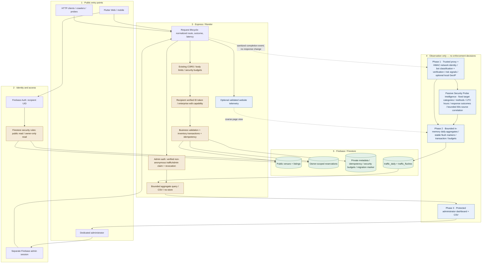

# BoxMatch security architecture / 整體資安架構

This diagram separates existing authorization/business enforcement from the optional, observation-only request intelligence, traffic aggregation and passive security probe extension. It describes source architecture; actual deployment flags and production coverage require operator verification.

## Trust boundaries / 權限邊界

| Boundary | Responsibility |
|---|---|
| Public client → Firestore | Public catalog and owner-scoped reservation reads only. Direct My Reservations queries are opt-in, use authenticated UID, and bypass Express observation. |
| Public client → Express | Existing token verification, capability checks, business limits, validation, inventory transactions and idempotency remain authoritative. |
| Express completion → observation | Best-effort classification and bounded counters; never alter response, authorize a request or block a scanner. Unknown paths use ordinary existing 404 behavior. |
| Observation → Firestore | Existing daily aggregate and flush-marker transaction; no raw IP, full path, fingerprint, payload, header or per-request document in probe analytics. Existing Phase 1 structured logs may contain pseudonymous network HMACs under the existing policy. |
| Administrator → protected API | Separate Firebase session, non-anonymous account and verified custom claim with revocation check. No direct client access to analytics documents; no-cache/no-store response and read/query budgets. |

## 中文架構說明

- **入口與身分層**：Flutter 使用 Firebase 驗證；Firestore Rules 隔離公開資料與擁有者預約，直接讀取需明確啟用。管理員獨立登入。
- **業務防護層**：Express 既有 CORS、請求限制、身分與編輯權杖驗證、交易及冪等負責真正的權限及一致性。觀測模組不介入判斷。
- **被動情資層**：Phase 1 解析可信代理、HMAC 網路指紋、爬蟲及風險；新增 Probe 分類及短期關聯，只保留固定類別及統計。
- **持久化與管理層**：Phase 2 共用有界限的每日聚合與冪等批次，Phase 3 經管理 API 取得儀表板及 CSV。Firestore 不保存逐筆 Probe 或指紋。
- **可見範圍**：僅到達 Express 的請求；GitHub Pages 靜態資源、直接 Firestore、代理先行拒絕的流量皆不在 API 觀測範圍。觀測訊號不是已確認入侵，亦不代表攻擊者身分。

## References

- [Passive Security Probe Intelligence](SECURITY_PROBE_INTELLIGENCE.md)
- [Request intelligence](REQUEST_INTELLIGENCE.md)
- [Traffic analytics](TRAFFIC_ANALYTICS.md)
- [Protected dashboard](TRAFFIC_DASHBOARD.md)
- [System design EN](system-design-review.en.md) · [繁體中文](system-design-review.zh-TW.md)
- [Reservation performance and read boundaries](ops/reservation-loading-performance.md)
