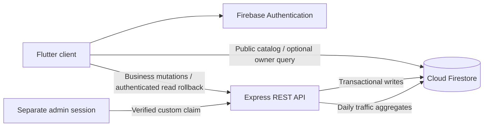

# BoxMatch system design review (EN)

Updated 2026-11-26 · [繁體中文](system-design-review.zh-TW.md)

## 1. Scope and constraints

BoxMatch coordinates surplus-food handoffs at exhibitions using public listings, maps, enterprise publishing and recipient reservations. The deployed architecture uses Flutter, Node.js/Express, Firebase Authentication and Firestore, with GitHub Pages and Render. The goal is safe business transactions and useful operational visibility within a free-tier footprint; this is not an always-on SLA or a commercial-scale analytics warehouse.

## 2. Runtime architecture

| Path | Authority and trade-off |
|---|---|
| Public listings and venues | Direct Firestore reads; no private credentials in public listing documents. |
| My Reservations | Optional owner-filtered, server-source Firestore query using authenticated UID; no Render dependency on reads. Default/rollback path is authenticated Express. |
| Reserve, cancel, confirm and inventory | Express validates identity/capability and business rules, then uses Admin SDK transactions. |
| Enterprise posting/edit | Low-friction edit capability with hashed secret stored in `listing_private`, rotation/revocation and server-derived ownership. Verified enterprise status requires authenticated owner identity. |
| Traffic dashboard | Separate Firebase Auth session with verified non-anonymous `trafficAdmin === true` claim; protected server API, not client access to analytics collections. |

## 3. Data model and design rationale

| Collection | Design rationale |
|---|---|
| `venues`, `listings` | Top-level collections support shared venue reference data and cross-venue feed/map queries. |
| `reservations` | Top-level documents with `listingId` and `claimerUid` enable both listing-centric and owner-centric access. |
| `listing_private` | Isolates edit token hashes, enterprise key and ownership from public documents. |
| `idempotency_keys` | Stable request replay records allow retry without duplicate inventory decrement. |
| `security_budgets`, `abuse_signals` | Server-owned admission budgets and abuse evidence; transaction-based limits and bounded writes. |
| `verified_enterprises`, `badge_rules` | Server-managed trust and badge policy separate from user-supplied data. |
| `kpi_daily`, `kpi_summary`, optional `kpi_events` | Business reporting separate from traffic monitoring. |
| `traffic_daily`, `traffic_flushes` | Daily aggregate schema and stable flush markers support bounded, duplicate-resistant persistence. |
| `schema_migrations` | Server-only versioned migration completion marker; avoids repeated listing scans after successful migration. |

## 4. Security and transaction consistency

The reviewed production blueprint requires recipient Firebase ID tokens (`REQUIRE_ID_TOKEN=true`). The authoritative UID is derived from the verified token; body UID cannot override it. Legacy UID-only mode is reserved for explicitly configured isolated development. Firebase anonymous sign-in gives recipients an identity without a conventional account. A local fallback identity does not authorize Firestore reservation reads.

Reserve operations validate quantity and decrement available stock atomically. Repeated reserve attempts reuse an idempotency key; cancellation and pickup confirmation retain server-side authorization and transaction checks. Enterprise updates revalidate credentials and preserve allocated inventory. Verified badges bind to a registered owner rather than an alias. Private metadata is migrated before the HTTP listener opens; a failed migration or marker write blocks startup. A forced legacy-import rescan invalidates completion first.

Firestore rules deny client writes to protected collections. Direct reservation queries must constrain `claimerUid` to the authenticated owner. Unauthorized/foreign/unfiltered queries fail; there is no permission-denial API fallback. Administrator credentials and custom claims do not grant direct traffic collection access. Token-bearing routes exclude frontend telemetry; the web referrer policy is origin-only `strict-origin` to preserve map compatibility.

## 5. Performance and reliability

- Optional direct reservation reads remove the Render wake-up dependency for list retrieval. The repository revalidates a 30-second UID-scoped in-memory snapshot, invalidates it after mutations and rejects stale identity results. Cached data is labeled refreshing and actions are unavailable until confirmed.
- Reservation records and pickup codes render before optional listing details; unique listing IDs are fetched in batches of at most six with five-second deadlines.
- Identity and list loading are bounded; nested page retries are removed. Rollback API list calls use at most two attempts. The reservation route loads eagerly; enterprise polling uses backoff.
- Versioned privacy migration replaces the repeated startup scan with one marker lookup after success. A cold first startup still performs migration; Render free-tier cold starts remain for API calls.

See [reservation performance](ops/reservation-loading-performance.md) for rollout, measurement and rollback.

## 6. Traffic intelligence and operational boundaries

See the [overall security architecture diagram](SECURITY_ARCHITECTURE.md) and [Passive Security Probe Intelligence](SECURITY_PROBE_INTELLIGENCE.md). The optional probe extension reuses request lifecycle classification, bounded daily persistence and the authorized dashboard/CSV, adding fixed target, method, UTC hour and response dimensions plus a bounded process-local 60-second trusted HMAC correlation window. It does not create fake resources or enforce policy. Historical gaps remain unobserved, and direct Firestore/static traffic bypasses this pipeline.

Request Intelligence is observation-only: classify requests/crawlers, optionally verify crawler identity, score behavioral signals and enrich country/ASN using optional local databases. Raw IPs are not included in the structured observation logs; fingerprinting requires a secret and trusted network resolution. Frontend page views are opt-in and do not identify individual visitors or reconstruct prior traffic.

Traffic analytics uses bounded in-memory aggregation, stable batch markers, transactional persistence, write/read budgets and explicit coverage status. A timed-out SDK write retains its slot until settlement to avoid uncertain duplicate commits. The dashboard exposes bounded daily summaries and CSV through authorized no-store endpoints; unknown/missing/invalid data is not represented as observed zero. No automatic bot blocking, queue service, Redis or paid infrastructure is introduced.

Limitations: direct Firestore and static-only requests bypass Express; telemetry is best effort and publicly submitted; process-local budgets are not project-wide quotas; an indefinitely hung SDK operation can still require restart. GeoIP requires verified proxy topology and provisioned local data. The dashboard is not an audit-grade ledger, unique-visitor tracker or real-time request monitor.

## 7. Verification and operational acceptance

The merged baseline as of 2026-11-26 passed [all five PR checks](https://github.com/LEO0331/boxmatch/pull/57/checks): backend 546 tests / 31 suites, Flutter 89.32% line coverage (80% gate), actual Firestore emulator owner-only read/write-denial tests, and both browser configurations. The backend npm audit reported zero vulnerabilities at that revision. These results do not establish deployed rules, production latency or quota usage.

Remaining operator checks: confirm actual Render root and commands, proxy trust, Firebase rules, administrator provisioning/revocation, dashboard aggregation and optional geo data, reservation rollout and cold/warm timing, existing map/pickup flows, and resource consumption. See [deployment runbook](ops/deploy-runbook.md) and [final review](TRAFFIC_FINAL_REVIEW.md).

## 8. Engineering discussion

- Why not client-direct mutations? Centralized identity, business validation, inventory consistency and idempotency remain easier to enforce in a transaction.
- Why direct reads only for My Reservations? Owner-filtered security rules are emulator-tested; this removes a cold-start dependency without moving inventory authority to the client. The trade-off is reduced Express read observability.
- Why versioned migration? Fail-closed initialization protects legacy privacy while avoiding repeated database work on later boots.
- Why aggregate analytics rather than a warehouse? Bounded resource consumption and privacy minimization fit current scope. A paid service or more advanced enforcement should be justified by measured demand, not added speculatively.
