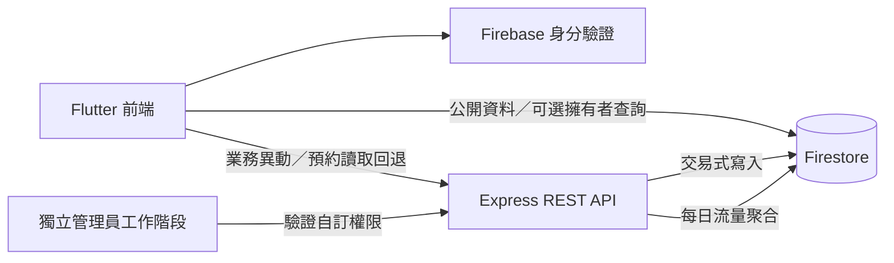

# BoxMatch 系統設計審查（繁體中文）

更新日期：2026-11-26 · [English](system-design-review.en.md)

## 1. 範圍與設計約束

BoxMatch 為展場剩食媒合平台，整合公開餐食列表、地圖、企業發布、預約與取餐交接。採 Flutter、Node.js／Express、Firebase Authentication、Cloud Firestore，透過 GitHub Pages 與 Render 部署。設計目標是在免費層成本限制下保障交易一致性與營運可觀測性，並非承諾常駐服務 SLA 或大型分析倉儲。

## 2. 現行架構與權限邊界

| 路徑 | 權限與取捨 |
|---|---|
| 公開餐食與場館 | 直接讀取 Firestore；公開 listing 不存放私人憑證。 |
| 我的預約 | 可選依 Firebase UID 限定擁有者的 Firestore 伺服器端資料查詢，避免 Render 冷啟動；預設／回退採已驗證 Express API。 |
| 預約、取消、取餐確認與庫存 | 後端驗證身分或編輯權杖，檢查業務規則並以 Admin SDK transaction 寫入。 |
| 企業發布與編輯 | 低摩擦的編輯權杖，雜湊存於 `listing_private`，支援輪替、撤銷與伺服器判定所有權；驗證企業須綁定已驗證的擁有者。 |
| 流量管理儀表板 | 獨立 Firebase Auth 工作階段，後端驗證非匿名身分與 `trafficAdmin === true` 自訂權限，不開放前端直接讀取分析集合。 |

## 3. 資料模型與選型

| 集合 | 用途 |
|---|---|
| `venues`、`listings` | 頂層集合利於場館共用與跨場館列表／地圖查詢。 |
| `reservations` | 使用 `listingId` 與 `claimerUid`，支援企業及領取者查詢。 |
| `listing_private` | 隔離編輯權杖雜湊、企業識別鍵與所有權。 |
| `idempotency_keys` | 保存冪等重試紀錄，避免重複扣減庫存。 |
| `security_budgets`、`abuse_signals` | 後端專用資源預算與濫用訊號，限制寫入規模。 |
| `verified_enterprises`、`badge_rules` | 分離企業信任及徽章政策與前端輸入。 |
| `kpi_daily`、`kpi_summary`、可選 `kpi_events` | 業務指標報表，與請求流量監控分離。 |
| `traffic_daily`、`traffic_flushes` | 每日聚合及穩定批次標記，限制資源使用並防止不確定提交時重複計數。 |
| `schema_migrations` | 後端專用版本化遷移完成標記，避免重複全量掃描。 |

## 4. 安全性與交易一致性

Render 藍圖設定 `REQUIRE_ID_TOKEN=true`，領取者 UID 由後端驗證過的 Firebase ID Token 決定，不能由 request body 自行指定其他身分。舊 UID-only 模式只供明確設定的隔離開發環境使用。匿名登入降低使用者門檻，但本機 fallback ID 不具備 Firestore 預約存取權限。

預約以 Firestore transaction 檢查並原子扣減庫存，重試沿用冪等鍵；取消、取餐確認、企業修改仍由後端驗證，保留庫存及憑證一致性。企業驗證徽章綁定已登錄擁有者而非別名。舊公開憑證遷移須在 HTTP listener 啟動前完成，失敗時停止啟動；強制重新掃描前先使舊完成標記失效。

Firestore Rules 禁止客戶端直接寫入受保護集合。預約讀取須限制 `claimerUid` 等於已驗證 UID，未授權、跨使用者及未限定查詢均遭拒；權限拒絕時不自動改走 API。管理員權限不授予直接讀取流量集合。含權杖路徑不送前端遙測，網頁使用僅傳 origin 的 `strict-origin` referrer policy，保留地圖相容性。

## 5. 效能與可靠性

- 啟用直接預約讀取後，不需等待 Render 喚醒。使用依 UID 隔離的 30 秒記憶體快照，重新驗證資料，異動後失效，拒絕舊身分的延遲結果；重新確認期間禁止操作。
- 預約與取餐碼優先呈現，餐食詳情獨立載入，每個 listing ID 去重，每批最多六個查詢，各有五秒期限。
- 身分與預約載入設期限，移除整頁重試；API 回退路徑最多兩次請求。預約頁改為 eager loading，企業查詢維持退避策略。
- 隱私遷移成功後，後續啟動僅需讀取版本化標記。首次仍需完成全量遷移；Render 免費層 API 呼叫仍可能有冷啟動。

詳見[預約效能與回退](ops/reservation-loading-performance.md)。目前無正式環境延遲量測，不宣稱改善百分比。

## 6. 流量智慧分析與營運邊界

Request Intelligence 為觀測用途：請求與爬蟲分類、可選爬蟲身分驗證、行為風險評分與可選本機國別／ASN 資料。結構化觀測日誌不含原始 IP；網路指紋需安全密鑰與可信代理設定。前端遙測為可選功能，不追蹤個人訪客或重建舊流量。

Traffic Analytics 採有限記憶體聚合、穩定批次標記、交易式持久化及讀寫預算。提交逾時時保留原 SDK 作業位置直到完成，避免不確定結果重複提交。管理端每日摘要與 CSV 經授權且禁止快取，缺失、無效或不支援資料與觀測值零明確區分。不加入自動爬蟲封鎖、Redis、佇列服務或付費基礎設施。

限制：直接 Firestore 與純靜態流量不進入 Express；遙測屬 best-effort；單程序預算不等於專案配額；SDK 永久卡住可能需重啟。GeoIP 需正確代理設定與本機資料庫。儀表板不是即時請求監控、獨立訪客統計或稽核級帳本。

## 7. 驗證與營運驗收

2026-11-26 合併基準的[五項 CI 檢查均通過](https://github.com/LEO0331/boxmatch/pull/57/checks)：後端 31 suites／546 tests、Flutter 行覆蓋率 89.32%（門檻 80%）、實際 Firestore Emulator 擁有者讀取與禁止客戶端寫入驗證、兩種瀏覽器功能配置。當次後端 npm audit 回報零漏洞。CI 結果不等同正式環境規則、延遲或配額的驗證。

剩餘營運確認：Render 實際根目錄、啟動命令、可信代理設定；Firebase 正式規則與管理員授權／撤銷；聚合及可選地理資料；預約讀取開關、冷熱啟動時間、原有地圖與取餐流程及資源使用。參考[部署手冊](ops/deploy-runbook.md)與[最終審查](TRAFFIC_FINAL_REVIEW.md)。

## 8. 工程設計討論

- 為何不讓前端直接異動庫存？集中身分驗證、交易一致性、冪等與業務規則。
- 為何我的預約可直接讀取？擁有者查詢已通過 Emulator 規則測試，可移除冷啟動依賴而不改變寫入權威；代價為讀取不再進入 Express 觀測。
- 為何版本化遷移？兼顧隱私 fail-closed 啟動及後續開機成本。
- 為何使用每日聚合而非分析倉儲？符合現有成本、資源與資料最小化需求；依實測需求決定未來是否擴充。
